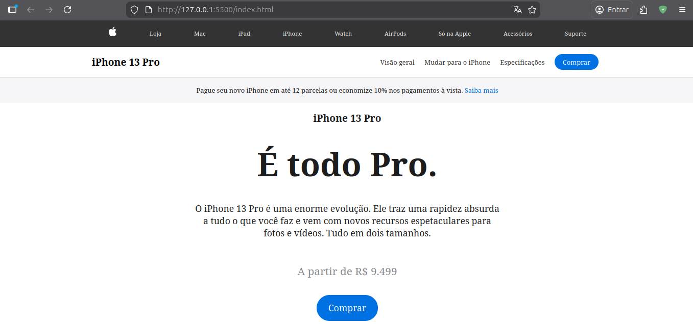
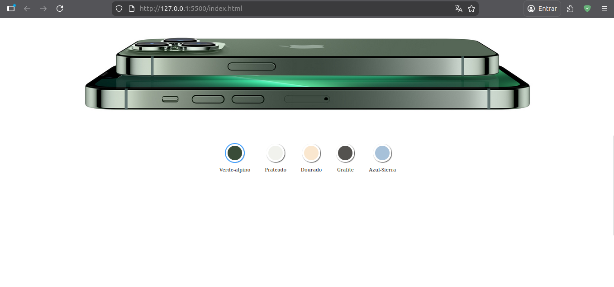
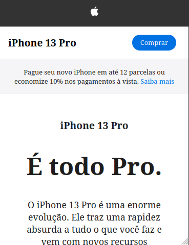
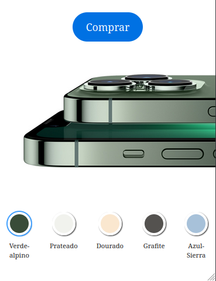

# iPhone 13 Pro - Sales Page

A premium landing page for the iPhone 13 Pro, featuring dynamic color switching and a modern, responsive design.

> [!NOTE]
> This project is for educational and study purposes only. It is a non-profit project created to practice web development skills.

## 🚀 Technologies Used

- **HTML5**: Semantic structure.
- **CSS3**: Advanced styling, transitions, and responsive layout.
- **JavaScript**: Interactive features and dynamic image switching.

## 📂 Project Structure

```text
.
├── assets
│   ├── css
│   │   └── styles.css
│   ├── img
│   │   ├── iphone_blue.jpg
│   │   ├── iphone_golden.jpg
│   │   ├── iphone_grafite.jpg
│   │   ├── iphone_green.jpg
│   │   ├── iphone_silver.jpg
│   │   └── logo_apple.svg
│   └── js
│       └── scripts.js
├── index.html
└── README.md
```

## 🛠️ How to Run

### 1. Clone the Repository

First, clone the project to your local machine:

```bash
git clone https://github.com/alexandrerogeriosn93/project-html-css-js-iPhone-sales-page.git
```

Then, navigate to the project folder:

```bash
cd project-html-css-js-iPhone-sales-page
```

### 2. Choose how to execute

#### Using Live Server (Recommended)

1. Open the project folder in **VS Code**.
2. If you don't have it, install the **Live Server** extension.
3. Click on the **Go Live** button in the bottom right corner of VS Code.
4. The page will automatically open in your default browser.

### Without Live Server

1. Navigate to the project directory.
2. Locate the `index.html` file.
3. Right-click the file and select **Open with**, then choose your preferred web browser (e.g., Chrome, Firefox, Edge).

## 📱 Previews

### Desktop Version




### Mobile Version



